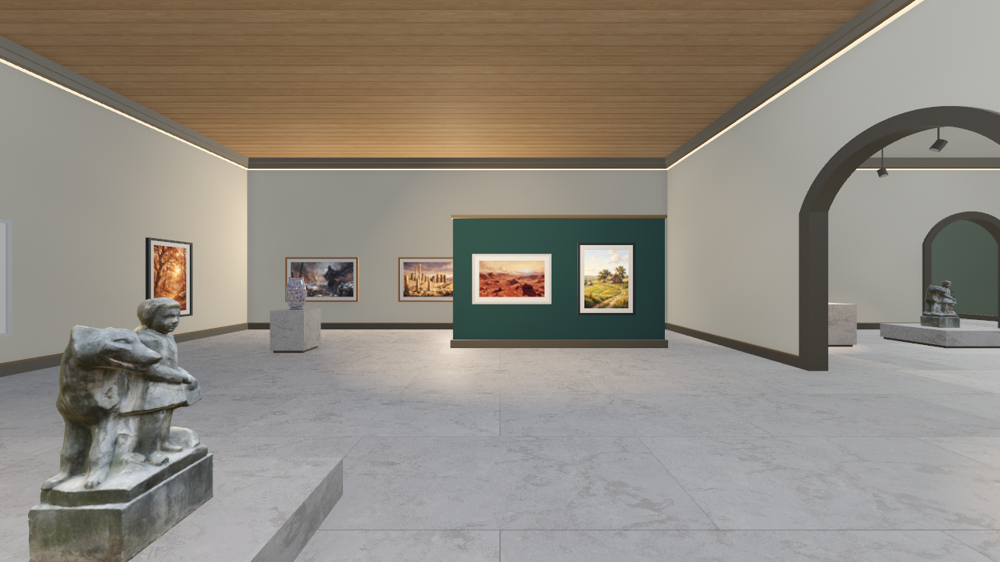

<picture>
  <source media="(prefers-color-scheme: dark)" srcset="assets/ui/museum-logo.png">
  
</picture>

# Museum of U

Turn a folder of photographs into a museum you can walk through. Bring a family album, a collection of travel photos, or start with the 21 photographs included with the game. Pause on a bench across from a favorite picture, explore the sculpture hall, or step outside to the reflecting pool and follow the path into the woods. Two music tracks accompany your visit, fading as you head outdoors.

## Quick Start

No need to install Godot or build anything yourself. Just download the game and start exploring.

1. Visit the **[Museum of U V1.0 Releases page](https://github.com/fellowgeek/museum-of-u/releases/tag/V1.0)**.
2. Download the appropriate binary for your operating system from the **Assets** section.
3. Extract the downloaded archive if necessary, then launch **Museum of U**.
4. Select **New visit → Start** to explore the museum with the included sample photographs.

Want to make the museum your own? Select **Open photos folder** from the title screen and add your favorite pictures.

## Run from Source

Prefer to run the project directly or make modifications? You'll need the standard **Godot 4.7.x** editor.

1. Open `project.godot` in Godot. Wait for the first import, then press **F5** to run the project. From a terminal, run `godot --headless --import` followed by `godot` in the project root.
2. Choose **New visit → Start**. The museum places sample photographs in an empty library, so you can explore right away.
3. Walk with **W A S D**, look around with the **mouse**, and press **Esc** to pause.

In the first Garden Lounge, follow the park-window wall to the open arch. A bronze spout feeds the pool just outside. Follow either end of the gravel path to the hardwood benches and animal sculpture in the clearing. Beyond the benches, you can leave the loop and wander among ferns, birches and firs. Both arms of the gravel loop lead back to the pool.

## Hang your own photographs

Choose **Open photos folder** on the title screen. This opens the exact folder the museum is using. On a fresh installation, it’s in your home folder.

| Platform | Default photo folder |
| --- | --- |
| macOS and Linux | `~/Museum of U` |
| Windows | `%USERPROFILE%\Museum of U` |

Copy JPEG, PNG or still WebP images into that folder. Albums in subfolders work too. Start a **new visit** to pick up your changes. The museum reads your originals in place and keeps their proportions on the wall. Pictures are sorted by folder and filename, so `2.jpg` comes before `10.jpg`.

The **Sample** album is yours to keep or remove. Add at least one of your own photographs before removing it if you want to see only your collection. An empty library gets the samples again on the next visit.

If you already keep a `photos` or `Photos` folder beside the app, the museum uses it when you have no home library yet. On a Mac, place it beside the outer **Museum of U.app**. When updating a portable installation, keep that folder with the new app.

## Controls and comfort

| Action | Keyboard and mouse | Controller |
| --- | --- | --- |
| Walk and look | W A S D and mouse | Left and right sticks |
| Sprint | Hold Shift | Hold L3 or LB / L1 |
| Open or close a service door | E | Y / Triangle |
| Toggle the flashlight | F | X / Square |
| Pause | Esc | Start / Options |
| Take a screenshot | P | Back / Share |

Open **Settings → Audio → Music** to adjust or mute the built-in soundtrack. The two tracks play in sequence and repeat. Music starts at 20% on a fresh installation. The music fades as you step outside and returns when you come back in. Under **Controls & Comfort** you can adjust mouse sensitivity, field of view and head bob. Try the **Low** graphics preset for a smoother visit on a slower computer.

For **Windows VR**, connect your headset and start its OpenXR runtime. Open the museum and choose **Enter VR** if the headset hasn’t entered automatically.

## Licenses and optional art

Game code is available under the [MIT License](LICENSE). See the [asset notices](docs/ASSETS.md) for visual and audio credits. **Credits & Licenses** is also available in the title and pause menus. The [local import guide](docs/LOCAL-IMPORTS.md) covers optional models.
